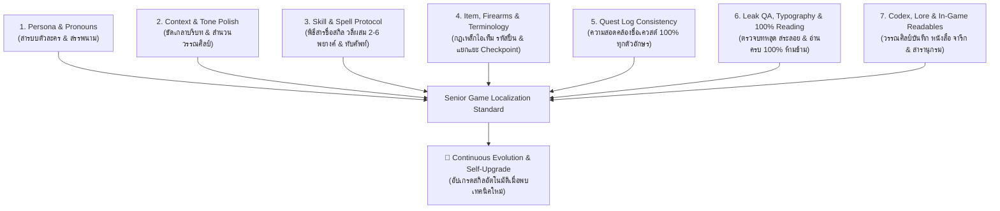

# 🎮 Game Localization QA & Translation Polish Master Protocol (The 7 QA Pillars)

[](https://github.com/memolyviza2012-max/game-localization-qa)
[](https://github.com/memolyviza2012-max/game-localization-qa)
[](https://github.com/memolyviza2012-max/game-localization-qa)
[](LICENSE)

> **The Ultimate Quality Assurance & Literary Polish Standard for Thai Game Localization.**  
> ยกระดับบทแปลเกมภาษาไทยจากการแปลตรงตัวแบบ Machine Translation (MT) ให้เป็นงานวรรณศิลป์เกมระดับ Masterpiece สละสลวย ถูกต้องตาม Lore เข้าปาก เข้าถึงอารมณ์ ปลอดภัยต่อเอนจิ้นเกม 100% พร้อมระบบอัปเกรดความรู้และสกิลอย่างต่อเนื่องอัตโนมัติ (Continuous Evolution Protocol)

---

## 🏛️ สถาปัตยกรรมเสาหลัก 7 มิติ (The 7 QA Pillars)



---

## 📖 สรุปเนื้อหาสำคัญของ 7 เสาหลัก

| เสาหลัก | จุดเน้นสำคัญ | ตัวอย่างข้อห้าม / ข้อบังคับ |
| :--- | :--- | :--- |
| **1. Persona & Pronouns** | ขจัดปัญหากฎทหารเหมารวม (Military Blanket Rule), ปรับสรรพนามตามเพศ ยุคสมัย (แฟนตาซี/ไซไฟ/ปัจจุบัน) และลำดับชั้นความสัมพันธ์ | ❌ ห้ามตัวละครหญิงพูด "ผม/ครับ" เด็ดขาด<br>✅ Master ในบริบท Pawn/Servant แปลว่า "นายท่าน" (ห้ามแปลว่า "อาจารย์") |
| **2. Context & Tone Polish** | ขจัดสำนวนแปลตรงตัวแข็งทื่อ (Anti-Literal Translation), แปลงสำนวนอุปมาอุปไมย (Idioms) เป็นสำนวนไทยที่เทียบเคียง | ❌ `'Twixt a rock and a hard place` ➔ ห้ามแปล "ระหว่างหินกับที่แคบ"<br>✅ แปลเป็นสำนวนไทย: **"กลืนไม่เข้าคายไม่ออก"** |
| **3. Skill & Spell Protocol** | ค้นคว้าแอนิเมชันและ Lore ก่อนแปล, ถอดชื่อสกิลเป็นวลีผสม 2-6 พยางค์ที่เห็นภาพการเคลื่อนไหว, ทับศัพท์เวทมนตร์และเทวตำนานอย่างถูกต้อง | ❌ `Strike` ➔ ห้ามแปล "นัดหยุดงาน"<br>❌ `Cooldown` ➔ ห้ามแปล "เย็นลง"<br>✅ `Whirlwind Slash` ➔ **"ดาบวายุหมุน"** / **"ฟันรอบทิศ"** |
| **4. Item & Terminology** | **กฎเหล็ก Checkpoint 2 กรณี:**<br>1) จุดเซฟ/เกิดใหม่/UI ➔ **"เช็คพอยท์"**<br>2) ด่านตรวจทหาร/ตำรวจ/ชายแดนในโลกจริง ➔ **"ด่านตรวจ"** / **"จุดตรวจ"** (ห้ามปะปน)<br>คงรหัสรุ่นปืนสากล (M4A1, AK-47, RPG-7 ห้ามทับศัพท์เป็นอักษรไทย) | ❌ `Checkpoint reached` ➔ ห้ามแปล "ถึงด่านตรวจแล้ว"<br>❌ `Enemy checkpoint` ➔ ห้ามแปล "เช็คพอยท์ของศัตรู"<br>❌ `Burst Fire` ➔ ห้ามแปล "ยิงระเบิด" (ต้องแปลว่า "ยิงชุด") |
| **5. Quest Log Consistency** | ชื่อเควสต์ในเมนูและแบนเนอร์แจ้งเตือนสำเร็จ/ล้มเหลวต้องตรงกัน 100% ทุกตัวอักษร, ประสานชื่อภารกิจแบบหลายตอน (Part 1, Part 2) ให้เป็นระบบเดียวกัน | ❌ ห้าม Part 1 ทับศัพท์ แล้ว Part 2 แปลความหมาย<br>❌ ห้ามแปล `ESCAPE` ในชื่อเควสต์เป็นปุ่ม `Esc` |
| **6. Leak QA & Typography** | กฎอ่านครบทุกประโยค 100% (ห้ามย่อความ/ห้ามสแกนผ่าน), ตรวจจับบทหลุดภาษาอังกฤษ/บทว่าง/อักษร CJK, ตรวจแก้วรรณยุกต์และสระลอย (เ+เ ➔ แ, สลับสระบน/ล่าง) | ❌ ห้ามทำตกหล่นแม้แต่บรรทัดเดียว<br>✅ ผสานคำวรรคผิด: `ลอบสัง หาร` ➔ **`ลอบสังหาร`** |
| **7. Codex & In-Game Readables** | กำหนดระดับภาษาตามประเภทเอกสาร (จารึกโบราณ, บันทึกการทดลอง, ไดอารีส่วนตัว, คำสั่งยุทธวิธี, สารานุกรมมอนสเตอร์), ร้อยเรียงย่อหน้าเป็นวรรณศิลป์ลื่นไหล, ปกป้องแท็กจัดหน้าหนังสือ | ❌ ห้าม AI ย่อความหนังสือยาวๆ เหลือ 2 บรรทัด<br>❌ ห้าม AI แต่งเรื่องต่อเติมเอง (No Hallucination) |

---

## 📥 วิธีติดตั้งและนำไปใช้งาน (Installation Guide)

### 1. ติดตั้งใน Google Antigravity (AGY)
คัดลอกไฟล์ `SKILL.md` ไปไว้ที่โฟลเดอร์สกิลของระบบ:
```bash
# Windows PowerShell
New-Item -ItemType Directory -Path "$env:USERPROFILE\.gemini\config\skills\game-localization-qa" -Force
Copy-Item "SKILL.md" -Destination "$env:USERPROFILE\.gemini\config\skills\game-localization-qa\SKILL.md" -Force
```

### 2. ติดตั้งใน Claude Code
คัดลอกไฟล์ `SKILL.md` ไปยังโฟลเดอร์สกิลของ Claude Code:
```bash
# Global Skills Directory
mkdir -p ~/.claude/skills/game-localization-qa
cp SKILL.md ~/.claude/skills/game-localization-qa/SKILL.md
```

### 3. ติดตั้งใน Cursor / Windsurf
- **Cursor:** คัดลอกเนื้อหาทั้งหมดใน `SKILL.md` ไปวางใน `.cursorrules` ของโปรเจกต์ม็อด หรือเพิ่มใน Settings > Rules for AI
- **Windsurf:** คัดลอกเนื้อหาทั้งหมดใน `SKILL.md` ไปวางใน `.windsurfrules`

### 4. ติดตั้งใน ChatGPT / Custom GPT / LLM อื่นๆ
นำเนื้อหาจาก `SKILL.md` ไปใส่ใน **System Prompt** หรือ **Custom Instructions** ของ Agent

---

## 💡 ตัวอย่างการสั่งงาน AI (Usage Examples)

เมื่อติดตั้งสกิลแล้ว คุณสามารถเรียกใช้ได้ทันทีด้วย Prompt เช่น:

```markdown
กรุณาตรวจแก้และขัดเกลาบทแปลของไฟล์นี้ด้วยสกิล game-localization-qa:
1. ตรวจสอบตามหลัก 7 เสาหลัก (Persona, Tone, Skills, Items, Quests, Typography, Codex)
2. แยกแยะ Checkpoint ระหว่าง 'จุดเซฟ' กับ 'ด่านตรวจทหาร' ให้ถูกต้องตามบริบท
3. ตรวจสอบสระลอย สระเอซ้อน (เ+เ) และบทหลุดแปล 100%
4. ห้ามลบหรือแก้ไขแท็กของ Game Engine เด็ดขาด
```

---

## 🔄 Continuous Evolution & Self-Upgrade Protocol

สกิลนี้ถูกออกแบบให้มี **ระบบอัปเกรดตัวเองอย่างต่อเนื่อง (Self-Upgrade Protocol)**  
เมื่อ AI หรือทีมแปลค้นพบ:
- 🆕 คำศัพท์เกมหรือสแลงใหม่เฉพาะทาง (เช่น Soulslike, Extraction Shooter, Gacha)
- 🛑 กับดักการแปลผิดมหันต์ตัวใหม่ของ Machine Translation (New MT Trap)
- ⚙️ เทคนิคการจัดการแท็กหรือฟอนต์เฉพาะของ Game Engine ใหม่ๆ (Unreal, Unity, RE Engine, RPG Maker, etc.)

AI สามารถนำเทคนิคใหม่นั้นมาอัปเกรดลงในเสาหลักที่เกี่ยวข้องของ `SKILL.md` เพื่อให้สกิลมีความสมบูรณ์แบบและครอบคลุมที่สุดอยู่ตลอดเวลา

---

## 📄 License

ลิขสิทธิ์เผยแพร่ภายใต้สัญญาอนุญาต [MIT License](LICENSE)  
พัฒนาและเรียบเรียงโดย **Danaiwit (memolyviza2012-max)** & Modder Community
