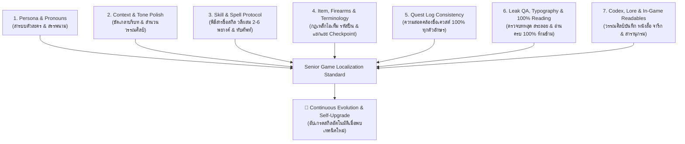

# 🎮 Game Localization QA & Translation Polish Master Protocol (The 7 QA Pillars)

[](https://github.com/memolyviza2012-max/game-localization-qa)
[](https://github.com/memolyviza2012-max/game-localization-qa)
[](https://github.com/memolyviza2012-max/game-localization-qa)
[](LICENSE)

> **The Ultimate Quality Assurance & Literary Polish Standard for Thai Game Localization.**  
> ยกระดับบทแปลเกมภาษาไทยจากการแปลตรงตัวแบบ Machine Translation (MT) ให้เป็นงานวรรณศิลป์เกมระดับ Masterpiece สละสลวย ถูกต้องตาม Lore เข้าปาก เข้าถึงอารมณ์ ปลอดภัยต่อเอนจิ้นเกม 100% พร้อมระบบอัปเกรดความรู้และสกิลอย่างต่อเนื่องอัตโนมัติ (Continuous Evolution Protocol)

---

## 🏛️ สถาปัตยกรรมเสาหลัก 7 มิติ (The 7 QA Pillars)



---

## 📖 สรุปเนื้อหาสำคัญของ 7 เสาหลัก

| เสาหลัก | จุดเน้นสำคัญ | ตัวอย่างข้อห้าม / ข้อบังคับ |
| :--- | :--- | :--- |
| **1. Persona & Pronouns** | ขจัดปัญหากฎทหารเหมารวม (Military Blanket Rule), ปรับสรรพนามตามเพศ ยุคสมัย (แฟนตาซี/ไซไฟ/ปัจจุบัน) และลำดับชั้นความสัมพันธ์ | ❌ ห้ามตัวละครหญิงพูด "ผม/ครับ" เด็ดขาด<br>✅ Master ในบริบท Pawn/Servant แปลว่า "นายท่าน" (ห้ามแปลว่า "อาจารย์") |
| **2. Context & Tone Polish** | ขจัดสำนวนแปลตรงตัวแข็งทื่อ (Anti-Literal Translation), แปลงสำนวนอุปมาอุปไมย (Idioms) เป็นสำนวนไทยที่เทียบเคียง | ❌ `'Twixt a rock and a hard place` ➔ ห้ามแปล "ระหว่างหินกับที่แคบ"<br>✅ แปลเป็นสำนวนไทย: **"กลืนไม่เข้าคายไม่ออก"** |
| **3. Skill & Spell Protocol** | ค้นคว้าแอนิเมชันและ Lore ก่อนแปล, ถอดชื่อสกิลเป็นวลีผสม 2-6 พยางค์ที่เห็นภาพการเคลื่อนไหว, ทับศัพท์เวทมนตร์และเทวตำนานอย่างถูกต้อง | ❌ `Strike` ➔ ห้ามแปล "นัดหยุดงาน"<br>❌ `Cooldown` ➔ ห้ามแปล "เย็นลง"<br>✅ `Whirlwind Slash` ➔ **"ดาบวายุหมุน"** / **"ฟันรอบทิศ"** |
| **4. Item & Terminology** | **กฎเหล็ก Checkpoint 2 กรณี:**<br>1) จุดเซฟ/เกิดใหม่/UI ➔ **"เช็คพอยท์"**<br>2) ด่านตรวจทหาร/ตำรวจ/ชายแดนในโลกจริง ➔ **"ด่านตรวจ"** / **"จุดตรวจ"** (ห้ามปะปน)<br>คงรหัสรุ่นปืนสากล (M4A1, AK-47, RPG-7 ห้ามทับศัพท์เป็นอักษรไทย) | ❌ `Checkpoint reached` ➔ ห้ามแปล "ถึงด่านตรวจแล้ว"<br>❌ `Enemy checkpoint` ➔ ห้ามแปล "เช็คพอยท์ของศัตรู"<br>❌ `Burst Fire` ➔ ห้ามแปล "ยิงระเบิด" (ต้องแปลว่า "ยิงชุด") |
| **5. Quest Log Consistency** | ชื่อเควสต์ในเมนูและแบนเนอร์แจ้งเตือนสำเร็จ/ล้มเหลวต้องตรงกัน 100% ทุกตัวอักษร, ประสานชื่อภารกิจแบบหลายตอน (Part 1, Part 2) ให้เป็นระบบเดียวกัน | ❌ ห้าม Part 1 ทับศัพท์ แล้ว Part 2 แปลความหมาย<br>❌ ห้ามแปล `ESCAPE` ในชื่อเควสต์เป็นปุ่ม `Esc` |
| **6. Leak QA & Typography** | กฎอ่านครบทุกประโยค 100% (ห้ามย่อความ/ห้ามสแกนผ่าน), ตรวจจับบทหลุดภาษาอังกฤษ/บทว่าง/อักษร CJK, ตรวจแก้วรรณยุกต์และสระลอย (เ+เ ➔ แ, สลับสระบน/ล่าง) | ❌ ห้ามทำตกหล่นแม้แต่บรรทัดเดียว<br>✅ ผสานคำวรรคผิด: `ลอบสัง หาร` ➔ **`ลอบสังหาร`**<br>✅ แก้สะกด ฎ/ฏ ผิด: `ปรากฎ` ➔ **`ปรากฏ`**, `ปฎิเสธ` ➔ **`ปฏิเสธ`**, `กฏ` ➔ **`กฎ`**<br>✅ แก้ไม้ยมก: `เร็วๆ` ➔ **`เร็ว ๆ`** ห้ามซ้อน `ๆๆ` |
| **7. Codex & In-Game Readables** | กำหนดระดับภาษาตามประเภทเอกสาร (จารึกโบราณ, บันทึกการทดลอง, ไดอารีส่วนตัว, คำสั่งยุทธวิธี, สารานุกรมมอนสเตอร์), ร้อยเรียงย่อหน้าเป็นวรรณศิลป์ลื่นไหล, ปกป้องแท็กจัดหน้าหนังสือ | ❌ ห้าม AI ย่อความหนังสือยาวๆ เหลือ 2 บรรทัด<br>❌ ห้าม AI แต่งเรื่องต่อเติมเอง (No Hallucination) |

---

## 📂 โครงสร้างไฟล์ (Progressive Disclosure Architecture)

```
game-localization-qa/
├── SKILL.md          # แกนกลาง: 7 เสาหลัก + ตาราง routing + workflow + self-upgrade
├── references/       # คู่มือเชิงลึกรายเสาหลัก (เปิดเฉพาะที่งานเกี่ยวข้อง)
│   ├── pillar-1-persona-pronouns.md
│   ├── pillar-2-context-tone.md
│   ├── pillar-3-skills-spells.md
│   ├── pillar-4-items-firearms.md
│   ├── pillar-5-quest-consistency.md
│   ├── pillar-6-leak-typography.md
│   └── pillar-7-codex-readables.md
└── data/             # คลังข้อมูลเชิงเครื่อง (canonical — เป้าหมายของ self-upgrade)
    ├── mt-traps.json          # กับดัก MT ทุกหมวด (idiom/skill/item/quest/codex)
    ├── transliteration.json   # คลังทับศัพท์ชื่อเฉพาะ/เวทมนตร์
    ├── pronouns-matrix.json   # เมทริกซ์สรรพนามตามยุค/ความสัมพันธ์
    ├── thai-orthography.json  # ฎ/ฏ, ๆ, วรรณยุกต์-สระลอย, การผสานคำ (พร้อม regex)
    ├── cjk-residue.json       # อักษร CJK ตกค้างจาก MT จีน→ไทย
    └── sound-cues.json        # แท็กเสียงประกอบซับไตเติล
```

> ⚠️ ต้องติดตั้ง **ทั้งโฟลเดอร์** ไม่ใช่ไฟล์ `SKILL.md` ไฟล์เดียว — เพราะ SKILL.md อ้างอิง `references/` และ `data/` ตามตาราง routing

---

## 📥 วิธีติดตั้งและนำไปใช้งาน (Installation Guide)

### 1. ติดตั้งใน Google Antigravity (AGY)
คัดลอกทั้งโฟลเดอร์ skill ไปยังโฟลเดอร์สกิลของระบบ (รันจาก root ของ repo):
```powershell
# Windows PowerShell
New-Item -ItemType Directory -Path "$env:USERPROFILE\.gemini\config\skills\game-localization-qa" -Force
Copy-Item "SKILL.md","references","data" -Recurse -Force -Destination "$env:USERPROFILE\.gemini\config\skills\game-localization-qa"
```

```bash
# macOS / Linux
mkdir -p ~/.gemini/config/skills/game-localization-qa
cp -r SKILL.md references data ~/.gemini/config/skills/game-localization-qa/
```

### 2. ติดตั้งใน Claude Code
คัดลอกทั้งโฟลเดอร์ skill ไปยังโฟลเดอร์สกิลของ Claude Code:
```bash
# macOS / Linux (Global Skills Directory)
mkdir -p ~/.claude/skills/game-localization-qa
cp -r SKILL.md references data ~/.claude/skills/game-localization-qa/
```

```powershell
# Windows PowerShell
New-Item -ItemType Directory -Path "$env:USERPROFILE\.claude\skills\game-localization-qa" -Force
Copy-Item "SKILL.md","references","data" -Recurse -Force -Destination "$env:USERPROFILE\.claude\skills\game-localization-qa"
```

### 3. ติดตั้งใน Cursor / Windsurf
- **Cursor:** คัดลอกเนื้อหา `SKILL.md` ไปวางใน `.cursorrules` ของโปรเจกต์ม็อด หรือเพิ่มใน Settings > Rules for AI (หมายเหตุ: แพลตฟอร์มไฟล์เดี่ยวจะได้เฉพาะแกนกลาง — แนะนำให้อ้าง path ของ `references/` และ `data/` ใน repo เพื่อให้ agent เปิดอ่านเพิ่มได้)
- **Windsurf:** คัดลอกเนื้อหาทั้งหมดใน `SKILL.md` ไปวางใน `.windsurfrules` (ข้อจำกัดเดียวกับ Cursor)

### 4. ติดตั้งใน ChatGPT / Custom GPT / LLM อื่นๆ
นำเนื้อหาจาก `SKILL.md` ไปใส่ใน **System Prompt** หรือ **Custom Instructions** ของ Agent

---

## 💡 ตัวอย่างการสั่งงาน AI (Usage Examples)

เมื่อติดตั้งสกิลแล้ว คุณสามารถเรียกใช้ได้ทันทีด้วย Prompt เช่น:

```markdown
กรุณาตรวจแก้และขัดเกลาบทแปลของไฟล์นี้ด้วยสกิล game-localization-qa:
1. อ่าน SKILL.md แล้วเปิด references/ และ data/ ตามตาราง routing ให้ตรงกับงานนี้
2. ตรวจสอบตามหลัก 7 เสาหลัก (Persona, Tone, Skills, Items, Quests, Typography, Codex)
3. แยกแยะ Checkpoint ระหว่าง 'จุดเซฟ' กับ 'ด่านตรวจทหาร' ให้ถูกต้องตามบริบท
4. ตรวจสอบสระลอย สระเอซ้อน (เ+เ) ฎ/ฏ ไม้ยมก (ๆ) และบทหลุดแปล 100%
5. ห้ามลบหรือแก้ไขแท็กของ Game Engine เด็ดขาด
```

---

## 🤖 เครื่องมือตรวจสอบอัตโนมัติ (Thai QA Checker)

ตัวสแกน/แก้ไขอัตโนมัติที่โหลดกฎทั้งหมดจาก `data/*.json` — Python 3 มาตรฐาน ไม่ต้องติดตั้ง dependency เพิ่ม:

```bash
# สแกนอย่างเดียว (dry-run)
python3 checker/thai_qa.py path/to/translation.txt

# สแกน + แก้อัตโนมัติ + บันทึก Audit Trail
python3 checker/thai_qa.py translation.txt --fix --report review.csv

# ไฟล์ CSV ระบุคอลัมน์ต้นฉบับ/คำแปล (เปิดการตรวจบทหลุดแปล)
python3 checker/thai_qa.py strings.csv --csv --source-col 1 --target-col 3 --fix

# ดูกฎทั้งหมดที่โหลดจาก data
python3 checker/thai_qa.py x --list-rules

# รันชุดทดสอบ
python3 -m unittest discover -s checker
```

- **แก้อัตโนมัติ:** สระเอซ้อน (เเ➔แ), วรรณยุกต์สลับที่, วรรณยุกต์หลังสระอำ, สระ/วรรณยุกต์ซ้ำ, ฎ/ฏ, ช่องว่างไม้ยมก (ๆ), การผสานคำที่ถูกวรรคคั่น
- **แจ้งเตือนให้คน/AI ตัดสิน:** กับดัก MT (เช่น "นัดหยุดงาน" ➔ ฟาดฟัน), อักษร CJK ตกค้าง (พร้อมคำแปลแนะนำ), ๆ ซ้อน, สระลอย, แท็กตัดแยกสระ, ช่องคำแปลว่าง/ไม่ได้แปล (โหมด CSV)
- **ความปลอดภัยไฟล์:** รักษา BOM/newline เดิม, จำนวนบรรทัดคงเดิม 100%, เขียนทับแบบ atomic write, ไม่แตะแท็กเอนจิ้นเกม (`{0}`, `%s`, `<COLOR>`, `<br>`)

---

## 📊 ชุดทดสอบและการวัดผล (Eval Set & Harness)

`eval/cases.json` เก็บเคสทดสอบ 48 เคสครบทั้ง 7 เสาหลัก (ต้นฉบับ + คำแปล MT ที่ตกกับดัก + เกณฑ์ accept/reject) ใช้ได้ 2 วัตถุประสงค์:

**1. Safety net กัน regression เมื่ออัปเกรดกฎ** — วัดว่า checker ยังจับกับดักที่รู้จักทั้งหมดได้ (baseline ปัจจุบัน: **100%**):
```bash
python3 eval/run_eval.py selftest    # ตรวจความสอดคล้องของชุดเคสเอง
python3 eval/run_eval.py checker     # วัด trap-coverage ของ checker (threshold 95%)
```

**2. วัดผล AI "มีสกิล vs ไม่มีสกิล" (A/B testing):**
```bash
python3 eval/run_eval.py template /tmp/no_skill.csv   # ให้ AI ชุด A แปลโดยไม่ให้อ่านสกิล
python3 eval/run_eval.py template /tmp/with_skill.csv # ให้ AI ชุด B อ่าน SKILL.md + references + data ก่อนแปล
python3 eval/run_eval.py translations /tmp/no_skill.csv     # ให้คะแนนแต่ละชุดแล้วเทียบกัน
python3 eval/run_eval.py translations /tmp/with_skill.csv --min-score 90
```
เกณฑ์การให้คะแนนอัตโนมัติ: คำแปลต้องมีอย่างน้อยหนึ่งรูปจาก `accept` และไม่มีสตริงใดจาก `reject` — ผลจะแยกตามเสาหลักพร้อมรายละเอียดเคสที่ไม่ผ่าน

---

## 🔄 Continuous Evolution & Self-Upgrade Protocol

สกิลนี้ถูกออกแบบให้มี **ระบบอัปเกรดตัวเองอย่างต่อเนื่อง (Self-Upgrade Protocol)**  
เมื่อ AI หรือทีมแปลค้นพบ:
- 🆕 คำศัพท์เกมหรือสแลงใหม่เฉพาะทาง (เช่น Soulslike, Extraction Shooter, Gacha)
- 🛑 กับดักการแปลผิดมหันต์ตัวใหม่ของ Machine Translation (New MT Trap)
- ⚙️ เทคนิคการจัดการแท็กหรือฟอนต์เฉพาะของ Game Engine ใหม่ๆ (Unreal, Unity, RE Engine, RPG Maker, etc.)

AI สามารถนำเทคนิคใหม่นั้นมา **append ลง `data/*.json` (canonical) ทันที** ตาม schema ที่กำหนดไว้ในแต่ละไฟล์ และเพิ่มกฎเชิงอธิบายใน `references/pillar-N.md` เมื่อจำเป็น เพื่อให้สกิลมีความสมบูรณ์แบบและครอบคลุมที่สุดอยู่ตลอดเวลา

---

## 📄 License

ลิขสิทธิ์เผยแพร่ภายใต้สัญญาอนุญาต [MIT License](LICENSE)  
พัฒนาและเรียบเรียงโดย **Danaiwit (memolyviza2012-max)** & Modder Community
