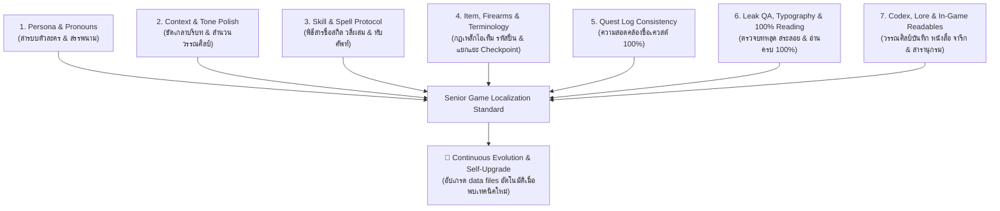
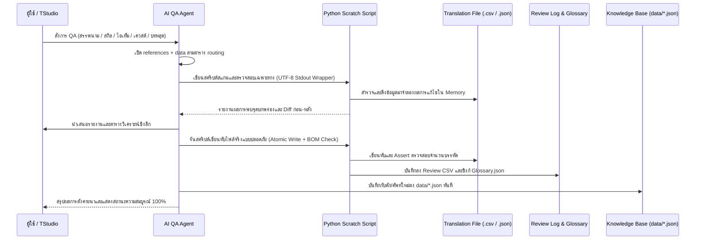

# 🎮 Game Localization QA & Translation Polish Master Protocol (The 7 QA Pillars)

> **Purpose:** กรอบพิธีสารมาตรฐานสากลสำหรับการตรวจแก้ ควบคุมคุณภาพ และขัดเกลาบทแปลเกมภาษาไทยระดับมืออาชีพ (Senior Thai Game Localization Editor & QA Lead) เพื่อยกระดับบทแปลจาก Machine Translation (MT) ให้เป็นงานวรรณศิลป์เกมระดับ Masterpiece ที่ถูกต้องตาม Lore สละสลวย เข้าปาก ปลอดภัยต่อไฟล์ Mod ของเกม 100% และมีระบบอัปเกรดความรู้แบบ data-driven ต่อเนื่อง

---

## 🗂️ โครงสร้างแบบ Progressive Disclosure (อ่านเฉพาะสิ่งที่งานต้องใช้)

ไฟล์นี้คือแกนกลาง — **ก่อนลงมือทำงานใดๆ ให้เปิดอ่าน reference และ data ตามตารางนี้เสมอ** ไม่ต้องอ่านทุกไฟล์:

| ลักษณะงาน | ไฟล์ที่ต้องอ่านก่อนลงมือ |
| :--- | :--- |
| สรรพนาม / บุคลิกตัวละคร | `references/pillar-1-persona-pronouns.md` + `data/pronouns-matrix.json` |
| ขัดเกลาสำนวน / idiom / tone / cultural review | `references/pillar-2-context-tone.md` + `data/mt-traps.json` (category: `idiom`) |
| ชื่อสกิล / เวท / ทับศัพท์ / กลไกการต่อสู้ | `references/pillar-3-skills-spells.md` + `data/transliteration.json` + `data/mt-traps.json` (`skill-name`, `skill-mechanics`) |
| ไอเท็ม / อาวุธปืน / ศัพท์ระบบ / Checkpoint | `references/pillar-4-items-firearms.md` + `data/mt-traps.json` (`checkpoint`, `firearms-item`, `fantasy-item`) |
| ชื่อเควสต์ / ความสอดคล้อง | `references/pillar-5-quest-consistency.md` + `data/mt-traps.json` (`quest-title`, `quest-rule`) |
| บทหลุด / สระลอย / ฎ-ฏ / ๆ / CJK / ความยาว UI / จังหวะซับ | `references/pillar-6-leak-typography.md` + `data/thai-orthography.json` + `data/cjk-residue.json` + `data/sound-cues.json` |
| Codex / หนังสือ / บันทึกในเกม | `references/pillar-7-codex-readables.md` + `data/mt-traps.json` (`codex-readable`) |
| **ทุกงานที่แตะไฟล์แปลจริง** | ทำตาม 🛠️ Autonomous Execution Workflow ด้านล่างเสมอ |
| วัดผล / ทดสอบสกิลหรือเครื่องมือ | `eval/run_eval.py` (`selftest`, `checker`, `template`, `translations`) + `eval/cases.json` |

**⭐ กฎเหล็กสากลที่ต้องยึดทุกงาน (ไม่ต้องรอเปิด reference):**
1. อ่าน ตรวจ และแปล **ทุกประโยค ทุกบรรทัด 100%** ห้ามข้าม ห้ามย่อความ ห้ามแต่งเติมเอง
2. ห้ามลบ แก้ หรือแปลแท็กของ game engine เด็ดขาด และคงจำนวนแท็ก/บรรทัด/encoding เดิมเป๊ะ
3. ใช้ data files เป็นคลังคำตอบก่อนตัดสินใจแปล และเมื่อพบกับดักใหม่ให้เพิ่มเข้า data files ทันที (ดู Self-Upgrade Protocol)

---

## 🏛️ สถาปัตยกรรมเสาหลักการตรวจสอบ 7 มิติ (The 7 QA Pillars)



---

## 🛠️ ขั้นตอนการปฏิบัติงานแบบอัตโนมัติ (Autonomous Execution Workflow)



### รายการตรวจสอบเชิงเทคนิคสำหรับ Python Script (Technical Checklist)
- **ใช้เครื่องตรวจสำเร็จรูปก่อนเขียนสคริปต์เอง:** `python3 checker/thai_qa.py <ไฟล์> [--fix] [--csv --source-col N --target-col N] [--report review.csv]` — โหลดกฎทั้งหมดจาก `data/*.json` อัตโนมัติ (ทดสอบด้วย `python3 -m unittest discover -s checker`)
- **แก้ปัญหา cp1252 บน Windows Terminal:**
  ```python
  import io, sys
  sys.stdout = io.TextIOWrapper(sys.stdout.buffer, encoding='utf-8')
  ```
- **การรักษา BOM และบรรทัด:**
  ```python
  # ตรวจสอบ BOM ก่อนเขียน
  # เขียนกลับด้วย encoding='utf-8-sig', newline=''
  assert len(verified_rows) == target_rows, "Line count mismatch!"
  ```
- **การบันทึกประวัติ (Audit Trail):** ทุกครั้งที่แก้ไข บันทึกลง `{Project}_Missed_Dialogue_Review.csv`: `[Row, File, Source, Original_Translation, Polished_Translation, Notes]`

---

## 🔄 พิธีสารการอัปเกรดต่อเนื่องแบบ Data-Driven (Continuous Evolution & Self-Upgrade Protocol v2)

เมื่อ AI หรือผู้ใช้พบสถานการณ์ใดๆ ต่อไปนี้ระหว่างทำงานแปลเกม:
1. **ศัพท์เกม/สแลงใหม่** เช่น Soulslike, Extraction Shooter, Gacha, MMORPG
2. **กับดัก MT ตัวใหม่** คล้ายกรณี Checkpoint, Strike, Breeches
3. **เทคนิค Game Engine ใหม่** เช่น Unreal Locres, Unity TextMeshPro Sprite Tags, RE Engine MSG, Naninovel, RPG Maker, Ren'Py, GameMaker
4. **เทคนิคฟอนต์/วรรณยุกต์ใหม่** เช่น การจัดตำแหน่งวรรณยุกต์, Bypass การตัดคำ, จัดการสระลอยในระบบเรนเดอร์เฉพาะ

### 🚀 ขั้นตอนการอัปเกรด (Step-by-Step):
1. **บรรจุลง data file ที่เกี่ยวข้องก่อนเสมอ (Canonical):** append entry ให้ครบ schema — `id`, `pillar`, `category`, `source`, `correct`, `forbidden[]`, `context?`, `note?` — แล้วอัปเดต field `updated` ของไฟล์
   - กับดักคำแปล/ศัพท์ระบบ ➔ `data/mt-traps.json` | ทับศัพท์ ➔ `data/transliteration.json` | ฎ/ฏ, ๆ, วรรณยุกต์ ➔ `data/thai-orthography.json` | อักษร CJK ➔ `data/cjk-residue.json` | แท็กเสียง ➔ `data/sound-cues.json` | สรรพนาม ➔ `data/pronouns-matrix.json`
2. **เพิ่มกฎเชิงอธิบายใน references/pillar-N.md** เฉพาะเมื่อข้อมูลใหม่ต้องมีเหตุผล/บริบทประกอบ (data file เพียงพอสำหรับรายการที่เป็นคู่แปลตรง)
3. **ซิงก์ความรู้ลง 3 ปลายทางหลักเสมอ (Sync Across 3 Master Destinations):**
   - 📍 **Global Agent Skill:** ไฟล์ skill ที่ติดตั้งจริงของ agent ที่ใช้งาน เช่น `~/.gemini/config/skills/game-localization-qa/` (Windows: `%USERPROFILE%\.gemini\config\skills\...`) หรือ `~/.claude/skills/game-localization-qa/`
   - 📍 **Central Modding Knowledge:** คลังความรู้กลางของทีม/ส่วนตัว เช่น `<KNOWLEDGE_BASE>/Modding-Knowledge/Skills/game-localization-qa/`
   - 📍 **Master Techniques Guide:** คู่มือเทคนิคหลักของโปรเจกต์ เช่น `<KNOWLEDGE_BASE>/Techniques/Thai_Game_Localization_QA_and_Gaming_Terminology_Guide.md`
4. **อัปเกรดเครื่องตรวจใน repo นี้ทันที:** กฎแบบคู่คำใหม่ใน `data/*.json` ใช้ได้กับ `checker/thai_qa.py` ทันทีโดยไม่ต้องแก้โค้ด — ส่วนกฎ regex โครงสร้างใหม่ต้องเพิ่ม handler ใน `checker/thai_qa.py` ด้วย แล้วรัน `python3 -m unittest discover -s checker` ยืนยันว่าไม่มี Regression และรัน `python3 eval/run_eval.py selftest && python3 eval/run_eval.py checker` ยืนยันว่า trap-coverage ไม่ตก (ผู้ใช้ TStudio ให้อัปเดต `tstudio_lite/qa/thai_checker.py` และ `tstudio-web/src/lib/qa/thaiChecker.ts` ด้วยลอจิกเดียวกัน)
